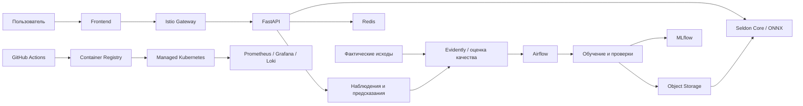

# Промышленное развертывание кредитной скоринговой системы с полным MLOps-циклом

<a target="_blank" href="https://cookiecutter-data-science.drivendata.org/">
    
</a>

Итоговый проект по дисциплине **«Автоматизация процессов доставки и развертывания моделей машинного обучения»**.

**Облачная платформа: Yandex Cloud.**

**Цель проекта:** развить существующую модель оценки вероятности дефолта клиента (Probability of Default, PD) в отказоустойчивую масштабируемую скоринговую систему с автоматизированной доставкой моделей, комплексным мониторингом и переобучением.

Полное техническое задание и чек-лист находятся в [task.md](task.md). В объём проекта включены **все задания, в том числе обозначенные в исходном задании как опциональные**.

## Текущий статус

Репозиторий содержит базовый проект предыдущего курса: подготовку данных, обучение классических моделей, MLflow, DVC, FastAPI, Docker и CI-проверки. Нейросеть, ONNX, инфраструктуру Yandex Cloud, Kubernetes, расширенный CD и платформенные компоненты мониторинга предстоит реализовать.

Разделы «Целевая архитектура», «Требования итогового проекта» и «Последовательность реализации» описывают план развития. Инструкции локального запуска ниже относятся к существующему коду. Наличие компонента в плане не означает, что он уже развернут или проверен.

## О проекте

Проект основан на **Default of Credit Card Clients Dataset**, который загружается через KaggleHub (`uciml/default-of-credit-card-clients-dataset`). Датасет содержит демографические характеристики, кредитные лимиты, историю платежей и выписки по счетам клиентов кредитных карт на Тайване за период с апреля по сентябрь 2005 года. Целевая переменная `default = 1` обозначает дефолт клиента.

Реализованная основа:

- валидация исходных и обработанных данных с помощью Pandera;
- очистка данных и построение признаков: сочетание пола и семейного положения, возрастные группы, относительные расходы;
- сравнение LogisticRegression, RandomForestClassifier, XGBClassifier и CatBoostClassifier с помощью GridSearchCV;
- оценка ROC-AUC, Precision, Recall и F1-Score на отложенной выборке;
- версионирование данных и артефактов через DVC, регистрация экспериментов и модели в MLflow;
- HTTP API на FastAPI и запуск в Docker;
- проверка дрейфа признаков и вероятностей предсказания с помощью PSI.

Пути к данным, модели, отчётам и артефактам определены в [src/config.py](src/config.py) относительно корня проекта. Переменная окружения `MLFLOW_DIR` позволяет изменить каталог хранения MLflow; по умолчанию используется `artifacts/mlflow`.

## Целевая архитектура

Предлагаемый стек для реализации задания:

| Назначение | Решение |
| --- | --- |
| Infrastructure as Code | Terraform, модули network, kubernetes, storage, monitoring, IAM и registry |
| Оркестрация | Yandex Managed Service for Kubernetes, CPU- и GPU-группы узлов |
| Образы | Yandex Container Registry, отдельные образы frontend/backend и ML-задач |
| Хранение | Yandex Object Storage для данных, моделей, отчётов и remote state |
| Модель | Нейросеть PyTorch, экспорт в ONNX, quantization, ONNX Runtime |
| API и интерфейс | FastAPI и отдельный frontend для запросов к скоринговой системе |
| Управление моделями | Seldon Core, версионированные артефакты и MLflow |
| Маршрутизация | Istio, Blue-Green, Canary, A/B и shadow deployment |
| Метрики | Prometheus, Grafana, Alertmanager |
| Логи | Loki и Grafana Alloy, дашборды и алерты по логам |
| Мониторинг модели | Evidently AI, data drift, concept drift и ухудшение качества |
| Переобучение | Airflow DAG с запуском ML-задач в Kubernetes |
| Кеширование | Redis с учётом версии модели и предобработки |
| CI/CD | GitHub Actions: build → test → deploy → monitor, security scanning и rollback |



Предобработка и контракт входных признаков должны совпадать при обучении и инференсе. FastAPI сохраняет внешний `/predict`; сначала ONNX Runtime можно вызывать в процессе API, затем вынести инференс в Seldon Core. Версии Seldon, Istio, Kubernetes и библиотек ML необходимо согласовать перед реализацией.

Для staging и production планируются отдельные конфигурации и состояния Terraform. Bucket для remote state и первоначальные права доступа создаются отдельным bootstrap-этапом. Terraform управляет облачными ресурсами, Helm и Kubernetes-манифесты — приложениями и платформенными сервисами.

## Требования итогового проекта

Все пункты таблицы входят в обязательный объём работ. Подробные задачи и отметки выполнения ведутся в [task.md](task.md).

| Этап задания | Результат, который необходимо получить |
| --- | --- |
| 1. Подготовка модели | Новая NN, ONNX, скрипт проверки корректности конвертации, quantization, сравнение качества и размера, CPU/GPU benchmarks и выбор ресурсов production |
| 2. Cloud Infrastructure as Code | Модульный Terraform для Yandex Cloud, remote state в Object Storage, Managed Kubernetes, CPU/GPU node groups, security groups и сетевые политики |
| 3. Контейнеризация и оркестрация | Многостадийные сборки frontend/backend, DVC в ML-образе, Deployment с rolling update, ConfigMaps, Secrets, Service и Ingress |
| 4. CI/CD | Build → test → deploy → monitor, проверки безопасности и уязвимостей, автоматическая доставка в staging/production, Blue-Green с Istio, Canary и автоматический rollback |
| 5. Observability | Prometheus, Grafana, централизованные логи Loki, дашборд логов, алерты по метрикам и логам, runbook и проверка сценариев инцидентов |
| 6. Дрифт и управление моделями | Evidently AI, data/concept drift, model performance decay, дашборды дрифта, Seldon Core, A/B-тестирование и shadow deployment |
| 7. Переобучение и автоматизация | Airflow DAG по расписанию, триггеры по данным и дрифту, автоматические проверки новых моделей, автомасштабирование кластера, географическая репликация и Redis |

### Условия проверки результатов

- **ONNX и оптимизация:** сравнить исходную NN, ONNX FP32 и оптимизированную модель на одинаковых данных. Проверку численной близости конвертации выполнять отдельно от проверки допустимого изменения качества после quantization.
- **Benchmarks:** фиксировать оборудование, версии ПО, batch size, параллелизм, прогрев, latency p50/p95/p99, throughput, память и загрузку CPU/GPU. Отдельно измерять инференс и полный HTTP-запрос, с кешем и без него. Выбор ресурсов делать по результатам измерений.
- **Воспроизводимость:** связывать версию модели с Git SHA, DVC-версией данных, MLflow run, предобработкой, схемой признаков и метриками. В production продвигать тот же артефакт и digest образа, которые проверены в staging.
- **Релизы:** для Canary и rollback определить пороги ошибок и latency, длительность наблюдения и минимальный объём запросов. A/B требует устойчивого назначения варианта клиенту; shadow отправляет копию запроса кандидату, сохраняя ответ основной версии.
- **Качество модели:** data drift сам по себе не подтверждает concept drift. Для оценки concept drift и performance decay собирать фактические исходы, связывать их с предсказаниями и рассчитывать метрики по окнам наблюдения.
- **Переобучение:** обучать кандидата на версионированном snapshot, проверять качество и конвертацию до доставки; исключить повторные запуски для одного snapshot и бесконечное переобучение из-за одного drift-события.
- **Масштабирование и география:** отдельно проверять рост числа pod и узлов кластера. Зафиксировать критерий географической репликации: несколько зон обеспечивают зональную отказоустойчивость; резервное развертывание в другом регионе требует отдельной схемы копирования артефактов и переключения. Проверить доступность нужных сервисов в выбранных локациях и измерить восстановление.

Исторический датасет проекта не содержит непрерывного потока новых наблюдений. Для демонстрации мониторинга и переобучения необходимо подготовить воспроизводимые сценарии новых порций данных, сдвига признаков и ухудшения качества. Результаты симуляции следует явно отделять от наблюдений реальной эксплуатации.

## Последовательность реализации

Порядок учитывает зависимости компонентов: мониторинг нужен до автоматического продвижения релиза и rollback, а сбор фактических исходов — до оценки ухудшения качества.

1. **Контракт данных и артефактов.** Зафиксировать признаки, общую предобработку, train/validation/test и формат комплекта модели. Предобработка обучается только на train.
2. **Нейросеть.** Обучить PyTorch MLP, добавить validation, early stopping и MLflow. Для новой модели выбирать конфигурацию по ROC-AUC, дополнительно оценивать PR-AUC, Precision, Recall, F1 и калибровку вероятностей.
3. **ONNX и оптимизация.** Реализовать экспорт, проверку конвертации, quantization и локальный benchmark. Расширить DVC-пайплайн соответствующими этапами.
4. **Локальное приложение.** Подключить ONNX к API, добавить frontend, отдельные многостадийные образы и локальную интеграционную проверку. Разделить liveness, readiness и технические метрики API.
5. **Базовая инфраструктура Yandex Cloud.** Создать bootstrap, IAM, Object Storage, Container Registry, сеть и Managed Kubernetes; развернуть базовый сервис в staging.
6. **Observability.** Установить Prometheus, Grafana, Loki и Alertmanager, подготовить дашборды, алерты и runbook; проверить срабатывание на сценариях отказа.
7. **CI/CD.** Добавить security scanning, публикацию образов и автоматическую доставку в staging/production с проверкой работоспособности после развертывания.
8. **Управление моделями и релизы.** Подключить Seldon Core и Istio, реализовать Blue-Green, Canary, A/B, shadow и согласованный откат маршрута и версии модели.
9. **Мониторинг качества и дрифта.** Организовать сбор наблюдений и меток, отчёты Evidently, дашборды и триггеры.
10. **Airflow.** Автоматизировать обучение кандидата, проверки, регистрацию и передачу в процесс доставки; добавить расписание и триггеры по данным и дрифту.
11. **Нагрузка и отказоустойчивость.** Проверить CPU/GPU-конфигурации, HPA, масштабирование node groups, Redis и географическую репликацию. Подготовить итоговые отчёты и демонстрацию полного цикла.

GPU-группу можно подключить раньше для первоначальных измерений. Итоговые нагрузочные испытания выполняются после интеграции serving и маршрутизации.

## Текущая структура файлов и папок

```text
├── artifacts/mlflow/          # база экспериментов и артефакты MLflow
├── data/
│   ├── raw/                   # исходный UCI_Credit_Card.csv
│   ├── raw.dvc                # DVC-описание исходных данных
│   └── processed/             # очищенные данные с новыми признаками
├── docker-compose.yml         # запуск API с подключением каталога models
├── Dockerfile                 # образ API
├── dvc.lock                   # хеши зависимостей и результатов пайплайна
├── dvc.yaml                   # этапы prepare и train
├── Makefile                   # команды установки, обучения, API и проверок
├── models/                    # модель joblib и эталонные выборки
├── notebooks/                 # исследовательские ноутбуки
├── reports/                   # метрики и ROC-кривая
├── pyproject.toml             # зависимости и настройки инструментов
├── README.md                  # документация проекта
├── task.md                    # задание и полный чек-лист итогового проекта
├── setup.cfg                  # настройки flake8
├── src/
│   ├── api/                   # FastAPI, схемы запросов и клиент проверки API
│   ├── data/                  # загрузка, очистка и валидация данных
│   ├── features/              # построение признаков
│   ├── model_training/        # подбор моделей, обучение и оценка качества
│   ├── neural/                # нейросеть, ONNX, quantization и benchmark
│   ├── monitoring/            # расчёт PSI и симуляция дрейфа
│   └── config.py              # пути к данным и артефактам
├── tests/                     # тесты очистки, валидации и мониторинга
└── uv.lock                    # зафиксированные версии зависимостей
```

Каталоги данных и артефактов создаются при запуске соответствующих этапов.

### Планируемое расширение структуры

Следующие пути предложены для реализации; в `src/neural/` уже созданы начальные файлы:

```text
infrastructure/
├── bootstrap/
├── modules/
│   ├── network/
│   ├── kubernetes/
│   ├── storage/
│   ├── monitoring/
│   ├── iam/
│   └── registry/
├── environments/
│   ├── staging/
│   └── production/
└── scripts/
deploy/                        # манифесты и Helm-конфигурации приложения
frontend/                      # пользовательский интерфейс скоринга
docker/                        # Dockerfile backend, frontend и ML-задач
dags/                          # Airflow DAG переобучения
monitoring/                    # dashboards, alert rules, конфигурации логирования
docs/runbooks/                 # инструкции реагирования на инциденты
src/neural/
├── neural_network.py
├── train_nn.py
├── export_onnx.py
├── validate_onnx.py
├── quantize_onnx.py
└── benchmark.py
.github/workflows/
├── build-and-test.yml
├── deploy-staging.yml
├── deploy-production.yml
├── canary-release.yml
└── rollback.yml
```

## Локальная установка и запуск существующей реализации

Требуются Python **3.13**, `uv` и `make`. Все команды выполняются из корня проекта. Для контейнерного запуска нужны Docker и Docker Compose.

### Подготовка окружения и данных

```bash
make create_environment
make requirements
make data
```

`make requirements` выполняет `uv sync`, включая зависимости для разработки. Остальные команды пайплайна используют `uv run`, поэтому активация окружения для них не требуется.

`make data` загружает `data/raw/UCI_Credit_Card.csv`, если файл отсутствует, и сразу выполняет очистку, построение признаков и валидацию. Для загрузки нужен доступ к Kaggle. Если исходный CSV уже есть, повторно подготовить данные можно без скачивания:

```bash
make prepare-data
```

Результат подготовки — `data/processed/UCI_Credit_Card.csv`.

### Обучение и метрики качества

```bash
make train
```

Модели и сетки гиперпараметров заданы в [src/model_training/models_configuration.py](src/model_training/models_configuration.py). GridSearchCV выбирает лучшую модель по **accuracy** на пяти стратифицированных фолдах. Полный перебор может занимать значительное время.

Перед обучением данные делятся на обучающую и тестовую выборки: 80% / 20%, со стратификацией по целевой переменной и `random_state=42`. После подбора лучшая модель оценивается на отложенной тестовой выборке. ROC-AUC рассчитывается по вероятностям дефолта, Precision, Recall и F1-Score — по предсказаниям положительного класса `default = 1`.

Обучение сохраняет:

- `models/best_model.joblib` — обученный пайплайн предобработки и классификации;
- `models/train_reference.csv` и `models/test_reference.csv` — эталонные выборки для мониторинга;
- [reports/test_metrics.md](reports/test_metrics.md) — отчёт о качестве;
- [reports/test_metrics.json](reports/test_metrics.json) — числовые значения метрик;
- [reports/figures/roc_curve.png](reports/figures/roc_curve.png) — ROC-кривую.

В MLflow создаётся эксперимент `credit-default`, логируются параметры, результаты кросс-валидации, метрики и отчёты; модель регистрируется под именем `CreditDefaultModel`. Обучение напрямую использует локальную SQLite-базу MLflow, поэтому запуск сервера MLflow перед обучением не требуется.

### Обучение нейросети и подготовка ONNX

После подготовки данных запустите:

```bash
make train-nn
```

Команда последовательно обучает нейросеть, экспортирует её в ONNX,
проверяет совпадение предсказаний с PyTorch, затем выполняет квантизацию
и проверяет качество квантованной модели. При ошибке следующий этап не запускается.
Каждый запуск повторяет обучение и перезаписывает артефакты:

- `models/best_NN.joblib` — веса PyTorch;
- `models/best_scaler.joblib` — обученный скейлер;
- `models/credit_default_model.onnx` — исходная ONNX-модель;
- `models/credit_default_model_quant_dyn.onnx` — квантованная ONNX-модель;
- `reports/quantization.json` — сравнение качества и размеров моделей.

### Нагрузочное тестирование нейромодели

После `make train-nn` выполните:

```bash
make benchmark-nn
```

Сравниваются PyTorch FP32, ONNX FP32 и ONNX INT8: профили с доступом к 1/2/4
логическим CPU, батчи 1/32/256 и 1/4 параллельных клиента. По умолчанию каждый
вариант измеряется три раза по 2 секунды после 50 прогревочных запросов.
Измеряются p50/p95/p99 latency, requests/s, объектов/с, CPU и память процесса.
Во время GPU-прогонов также опрашиваются загрузка, память и мощность всей видеокарты.
Время включает сохранённый скейлер и возврат результата на CPU; HTTP и сеть исключены.

Для локальной NVIDIA GPU с CUDA 13/cuDNN 9 предусмотрена отдельная команда:

```bash
make benchmark-nn-gpu
```

Она устанавливает ONNX Runtime GPU и cuRAND в `/tmp/mlops-ort-gpu`, сохраняя
основное CPU-окружение, затем проводит CPU- и GPU-прогоны последовательно.
Требуются работающий NVIDIA-драйвер и доступ к GPU. Размещение ONNX-узлов
проверяется профилировщиком: вычисления на CPU не выдаются за GPU-результаты.
Динамический INT8 может не поддерживаться CUDA и будет отмечен как skipped.

Параметры можно изменить:

```bash
make benchmark-nn-gpu BENCHMARK_ARGS="--seconds 10 --repeats 5 --target-rps 1000 --slo-ms 10"
make benchmark-nn BENCHMARK_ARGS="--devices cpu --cpu-cores 1 2 --batch-sizes 1 --concurrency 1 4"
```

Отчёты: [reports/benchmark/benchmark.md](reports/benchmark/benchmark.md) и
[reports/benchmark/benchmark.json](reports/benchmark/benchmark.json). JSON содержит
сырые результаты повторов, характеристики хоста, версии ПО и SHA256 артефактов.
Рекомендация для production выбирается среди измеренных конфигураций по заданным
RPS и p95 с резервом throughput 50%. По умолчанию приняты предварительные требования:
1000 запросов/с и p95 ≤ 10 мс. Это локальный тест модели; перед production нужен
длительный HTTP-тест сервиса на целевом оборудовании.

### Просмотр экспериментов

```bash
make mlflow
```

Интерфейс доступен по адресу `http://127.0.0.1:5000`. По умолчанию сервер открывает базу `artifacts/mlflow/mlflow.db`.

Если обучение выполнялось с другим `MLFLOW_DIR`, при запуске сервера задайте соответствующие `MLFLOW_BACKEND_STORE_URI` и `MLFLOW_ARTIFACTS_DESTINATION`: команда `make mlflow` использует собственные настройки путей из Makefile.

### Запуск и проверка API

После обучения запустите API в отдельном терминале:

```bash
make api
```

Документация Swagger доступна по адресу `http://127.0.0.1:8000/docs`.

| Метод | Путь | Назначение |
| --- | --- | --- |
| GET | `/` | Перенаправление на Swagger |
| GET | `/health` | Проверка доступности обученной модели |
| POST | `/predict` | Класс и вероятность дефолта для одного клиента |

Запрос `/predict` содержит 23 исходных признака в нижнем регистре: `limit_bal`, `sex`, `education`, `marriage`, `age`, `pay_0`, `pay_2`–`pay_6`, `bill_amt1`–`bill_amt6` и `pay_amt1`–`pay_amt6`. Поля `ID`, целевая переменная и дополнительные признаки не передаются; новые признаки API рассчитывает самостоятельно. Все поля обязательны, лишние поля запрещены. Полная схема и ограничения доступны в Swagger и [src/api/models.py](src/api/models.py).

Пример запроса:

```bash
curl -X POST http://127.0.0.1:8000/predict \
  -H 'Content-Type: application/json' \
  -d '{
    "limit_bal": 20000, "sex": 2, "education": 2, "marriage": 1, "age": 24,
    "pay_0": 2, "pay_2": 2, "pay_3": -1, "pay_4": -1, "pay_5": -2, "pay_6": -2,
    "bill_amt1": 3913, "bill_amt2": 3102, "bill_amt3": 689,
    "bill_amt4": 0, "bill_amt5": 0, "bill_amt6": 0,
    "pay_amt1": 0, "pay_amt2": 689, "pay_amt3": 0,
    "pay_amt4": 0, "pay_amt5": 0, "pay_amt6": 0
  }'
```

Ответ содержит `prediction` (0 или 1) и `default_probability` (от 0 до 1). Если `models/best_model.joblib` отсутствует, `/health` и `/predict` возвращают HTTP 503; некорректный запрос возвращает HTTP 422.

В другом терминале можно отправить два примера из исходного датасета:

```bash
make test-api
```

Чтобы изменить порт, используйте одинаковое значение для сервера и клиентов:

```bash
make api APP_PORT=8123
# В другом терминале:
make test-api APP_PORT=8123
```

После замены модели перезапустите API: загруженная модель кэшируется в процессе.

### Мониторинг стабильности (PSI)

При работающем API и наличии эталонных выборок выполните:

```bash
make psi_test
```

Скрипт сравнивает обучающую выборку с тестовой и с её изменённой копией, где `pay_0` увеличен на 1. Для каждого сравнения в консоль выводятся PSI признака `pay_0` и PSI вероятности дефолта. Результаты сохраняются в `reports/psi_test.json` и `reports/psi_test.md`, а для выборки со сдвигом — в `reports/psi_drifted_test.json` и `reports/psi_drifted_test.md`. Предсказания запрашиваются по одной записи, поэтому проверка полного датасета может занимать время. Для другого порта используйте `make psi_test APP_PORT=8123`.

## Запуск в Docker

Сначала обучите модель локально командой `make train`, затем запустите:

```bash
docker compose up --build -d
docker compose logs -f app
```

API доступен по адресу `http://127.0.0.1:8000/docs`. Compose подключает локальный каталог `models` к `/app/models` в режиме чтения; обучение при запуске контейнера не выполняется. Проверка состояния контейнера обращается к `/health` и требует наличия модели.

Остановка:

```bash
docker compose down
```

## Воспроизведение пайплайна с DVC

Исходные данные описаны в `data/raw.dvc`, а этапы подготовки и обучения — в [dvc.yaml](dvc.yaml). При наличии исходного CSV запустите:

```bash
uv run dvc repro
uv run dvc metrics show
```

DVC выполняет изменившиеся этапы `prepare` и `train`, отслеживает обработанные данные, модель, эталонные выборки и отчёты. Загрузка исходного датасета не входит в DVC-пайплайн: при отсутствии файла сначала выполните `make data`. Для получения данных через `uv run dvc pull` требуется настроенное DVC remote с загруженными артефактами.

## Проверки проекта

```bash
uv run pytest tests
make lint
```

Тесты проверяют очистку данных, схемы валидации и мониторинг дрейфа. `make test` также запускает тесты, но использует `python` текущего окружения; перед его вызовом активируйте `.venv` командой `source .venv/bin/activate`. `make test-api` отдельно проверяет запущенный HTTP-сервис.

`make lint` проверяет код с помощью flake8, isort и black; `make format` применяет форматирование. Список доступных команд выводится через `make help`.

## CI/CD и стратегии доставки

[GitHub Actions](.github/README.md) выполняет проверки, сборку backend/frontend,
сканирование Trivy и публикацию в GHCR. Staging и production используют одинаковые
image digest. Доставка выполняется через Istio: Blue-Green, Canary
10 → 25 → 50 → 100%, проверки HTTP/latency и автоматический возврат трафика при
ошибке. Предыдущий слот сохраняется для ручного rollback.

[Инструкция Istio](infrastructure/kubernetes/istio/README.txt) содержит установку,
критерии допуска, команды диагностики и локальную демонстрацию:

```bash
bash scripts/test_istio_local.sh
```

Пока нет аккаунта Yandex Cloud, `CLOUD_DEPLOY_ENABLED` остаётся выключенным.
GitHub Environments, доступ к кластеру, DNS/TLS и настоящий артефакт DVC
необходимо настроить перед облачной доставкой; конфигурация approval production
описана в инструкции GitHub Actions.

## Материалы для итоговой сдачи

- Код, Terraform, Kubernetes-манифесты, конфигурации платформенных сервисов, CI/CD и Airflow DAG.
- Версионированный комплект модели: NN/ONNX, оптимизированный артефакт, предобработка, схема признаков, метаданные и метрики.
- Отчёты о качестве, конвертации, оптимизации и CPU/GPU benchmarks с командами воспроизведения.
- Дашборды метрик, логов и дрифта, правила алертинга и runbook.
- Демонстрация релизов, rollback, A/B, shadow, переобучения, масштабирования и географической репликации.
- Инструкции развертывания и эксплуатации staging/production, описание ограничений и результаты проверки всех пунктов [task.md](task.md).


## Локальное развёртывание frontend/backend в Kubernetes

Многостадийные образы, загрузка модели через DVC, Deployment с rolling update,
ConfigMaps, передача S3-ключей через Secret, Service, Ingress и сетевые политики
описаны в [инструкции этапа 3](infrastructure/kubernetes/README.txt).
Полная проверка без облачного аккаунта:

```bash
bash scripts/test_kubernetes_local.sh
```

Нужны Docker, kind, kubectl и окружение проекта; установка и версии инструментов
указаны в инструкции. Сценарий использует синтетическую модель, проверяет API,
форму frontend, обновление под трафиком и NetworkPolicy во временном кластере.
Облачное развёртывание требует настоящего артефакта модели и настроенного аккаунта.

### Observability (этап 5)

Метрики API `/metrics`, Prometheus, Grafana, Loki/Alloy и Alertmanager:
[развёртывание и проверки](monitoring/README.md),
[runbook инцидентов](monitoring/RUNBOOK.md).

### Drift и управление моделями (этап 6)

`make stage6-experiment` запускает локальный Seldon Core 2 с ONNX FP32/INT8,
Evidently-сценарии, A/B и shadow-проверки. `make stage6-monitoring` подключает
метрики к уже работающему Prometheus и дашборду Grafana.
[Запуск, пороги, зрелые метки и критерии сравнения](monitoring/stage6/README.md).

### Переобучение, кеш и масштабирование (этап 7)

`make stage7-experiment` запускает реальный Airflow DAG, проверяет кандидата
ONNX/Seldon, Redis, отказы и локальный CPU scale-out. `make stage7-monitoring`
подключает метрики к Grafana, `make stage7-credentials` показывает пароль Airflow.
[Инструкция и ограничения multi-region/cloud](monitoring/stage7/README.md).
