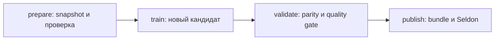

# Этап 7 Переобучение кеш и масштабирование

## Цель этапа

Связать сигнал об изменении данных с управляемым обучением новой версии и проверить обслуживание при нагрузке и отказах. Автоматизация не должна заменять модель только потому, что обучение завершилось: кандидат проходит независимый gate и регистрацию, а production-переключение остается отдельной операцией доставки.

Основные файлы: [Airflow DAG](../airflow/dags/credit_retraining.py), [pipeline](../src/retraining/pipeline.py), [training service](../src/retraining/service.py), [кеш](../src/api/prediction_cache.py), [инструкция этапа](../monitoring/stage7/README.md).

## Шаг 1 Разобрать границы Airflow и worker

Airflow определяет порядок задач и их повторение. Training worker выполняет тяжелую работу и сохраняет результаты в каталог run. DAG имеет четыре шага:



`credit_retraining` запланирован по понедельникам в 02:00 UTC, то есть 05:00 Москвы. `catchup=False` исключает автоматическое проигрывание всей старой истории. Один активный run ограничивает конкурирующие переобучения. Повтор успешного шага использует сохраненное состояние, а не создает незаметно другую модель.

`credit_retraining_events` каждые 5 минут проверяет новые данные и drift summary, затем запускает основной DAG. Event ID связан с содержимым; lease и обработанные ID не позволяют переобучаться бесконечно на одном событии.

## Шаг 2 Запустить стенд и изучить одну цепочку

Предварительно нужны processed CSV, ONNX, INT8 и scaler. Полный локальный сценарий:

```bash
make stage7-experiment
make stage7-credentials
```

Запускаются зависимости Seldon, Airflow, worker, Redis, ONNX-реплики и HAProxy. Команда выполняет обучение через настоящий DAG, демонстрирует new-data trigger, собирает candidate image и проверяет нагрузку/отказы.

Для пошагового изучения используйте вместо полного сценария:

```bash
make stage7-up
make stage7-retrain
make stage7-events
make stage7-candidate
make stage7-load
```

Это альтернативная последовательность, ее не требуется сразу повторять после полного эксперимента. Упражнение: сначала выполните только `stage7-up` и `stage7-retrain`, посмотрите каждую задачу в UI, затем переходите к событиям и нагрузке.

Airflow: `http://localhost:28080`, логин admin, пароль выводит `stage7-credentials`. Router API: `http://localhost:28000/docs`, worker: `http://localhost:28081/docs`. Пароль показывайте только в своем терминале, он не нужен в сдаваемом протоколе.

## Шаг 3 Защитить обучающие и проверочные данные

Champion-файлы `models/` не перезаписываются. Каждый run имеет свой каталог `artifacts/stage7/runs/`. Snapshot фиксирует хеши dataset/train/holdout/champion/scaler/code. Те же 6000 held-out объектов исходного разбиения не допускаются в train кандидата; новые batches с их ID отвергаются.

New-data CSV содержит id, исходные признаки, target, predicted_at, matured_at и observed_at. Проверяются схема, дубликаты, конечность вычисленных признаков и зрелость outcomes. Демонстрационный batch из `make stage7-events` помечен как симуляционный и не считается банковским потоком.

В локальном worker включены `STAGE7_LOCAL_ONLY=1` и отдельное разрешение симуляции. Его результат не должен незаметно вызывать внешнее production-действие. Сигнал drift сам по себе еще не означает наличие подходящих зрелых данных для обучения.

## Шаг 4 Понять новую модель и gate

Кандидат обучается как sklearn MLP 30→128→64→1 с ReLU/Sigmoid, своим StandardScaler и early stopping внутри train. У него нет BatchNorm/Dropout исходного PyTorch champion. Это другой вариант нейросети; совпадение ширины слоев не делает архитектуры одинаковыми.

ONNX строится из обученных весов кандидата. Его parity сравнивает sklearn и ONNX кандидата, а quality — кандидата и champion на одном holdout.

| Условие gate | Что предотвращает |
| --- | --- |
| Минимум 1000 объектов, оба класса | Некорректную или слишком малую оценку |
| AUC ≥0.65 и падение к champion ≤0.01 | Сильную деградацию ранжирования |
| Рост log loss ≤0.03 | Ухудшение вероятностных прогнозов |
| ONNX parity ≤1e-5, конечные вероятности [0,1] | Ошибку экспорта/контракта |
| p95 теплого batch=1 inference ≤100 мс | Неприемлемый CPU-инференс в тестовом режиме |

```bash
python -m json.tool artifacts/stage7/airflow-runs.json
make stage7-test
```

Чтобы изучить конкретный run, найдите его ID в `artifacts/stage7/last-run.txt`, затем откройте `prepared.json`, `trained.json`, `gate.json`, `registration.json` и `delivery.json` соответствующего каталога. Наличие отдельных файлов зависит от того, до какого этапа дошел run: отвергнутый кандидат не обязан иметь publish-результат.

Провал gate должен сделать DAG failed и остановить publish. Не уменьшайте требования, чтобы получить зеленую демонстрацию. Сохраните пример отклоненного кандидата: он показывает, что защитная логика действительно работает.

## Шаг 5 Проверить publication и передачу в CI/CD

Прошедшая gate модель получает новое имя Seldon и должна достичь ModelAvailable. Bundle включает ONNX, scaler и metadata. `delivery.json` связывает версию, bundle hash и статус кандидата. Отдельная сборка candidate image проверяет пригодность упаковки.

Успешная публикация кандидата не переключает production. Следующий допуск относится к CI/CD этапа 4: подтверждение артефакта, среда staging, мониторинг, затем дальнейшая доставка по выбранной стратегии. В учебном локальном стенде внешняя публикация выключена.

## Шаг 6 Разобрать кеш Redis

Кеш экономит повторные вычисления, но не является источником истины. Ключ строится из канонического запроса и идентичности модели/scaler через HMAC-SHA256. Благодаря включению хешей артефактов новая версия не получает ответы старой модели.

Локальный TTL — 60 секунд; Redis ограничен по памяти и использует LRU. При ошибке/недоступности кеша API выполняет настоящий inference: это fail-open. Поврежденный cached response также не должен превращаться в валидный ответ без проверки.

На дашборде смотрите hit/miss/error и readiness backend. Только hits не доказывают работоспособность модели: для проверки вычислений нужны новые запросы, которых нет в кеше.

Упражнение: объясните, почему кеш без версии модели может вернуть формально правильный JSON со старым прогнозом и почему после смены файлов модели требуется новый процесс/контейнер.

## Шаг 7 Отличить pod scaling от node scaling

Локальный autoscaler читает `docker stats`, увеличивает реплики после двух высоких замеров, уменьшает после четырех низких, использует cooldown. В load-сценарии порог специально снижен до 5% CPU на реплику для демонстрации; это не рекомендуемый production-порог.

Kubernetes HPA из `infrastructure/stage7/autoscaling.yaml` использует CPU 60%, min=2/max=6 и стабилизацию уменьшения 300 секунд. Ему нужны metrics-server и resource requests. HPA увеличивает число pod. YC node-group auto_scale увеличивает число узлов, когда возник дополнительный спрос на ресурсы. Это разные контуры управления.

При Blue-Green важно масштабировать нужный Deployment: HPA, направленный только на неактивный слот, не поможет активному API.

```bash
python -m json.tool artifacts/stage7/autoscaling.json
python -m json.tool artifacts/stage7/resilience.json
```

Проверьте реальные изменения числа реплик, число успешных/ошибочных запросов и восстановление исходного числа реплик после теста. Просто наличие YAML с HPA не подтверждает масштабирование.

## Шаг 8 Проверить failover площадки

Локальные site-a/site-b — контейнеры одного хоста. HAProxy проверяет `/ready`, использует основную площадку и резерв при ее отказе. Заголовки X-Serving-Region/Replica помогают установить, кто действительно ответил.

Тест проверяет отказ реплики, Redis и всей site-a. Это демонстрация топологии и маршрутизации, которая принимается в учебном объеме. Отключение общего хоста остановит обе площадки.

Для реального двухрегионального сценария подготовлен `scripts/stage7_geo.py`: независимые contexts, разные region labels и HTTPS endpoints, server dry-run, явный `--apply`, TLS/SNI edge config. Запускать его для сдачи не нужно; проверка требует подключения к двум кластерам даже без `--apply`.

## Шаг 9 Подключить дашборд и остановить стенд

При работающем мониторинге этапа 5:

```bash
make stage7-monitoring
```

Сопоставьте Airflow state, gate_passed, количество реплик и cache events. Если Airflow failed, сначала найдите конкретную задачу и ее ошибку; retry не исправит несовместимые данные или плохую модель.

```bash
make stage7-down
make stage6-down
```

Первая команда останавливает этап 7 с сохранением данных, вторая — его зависимости этапа 6. Мониторинг этапа 5 останавливается своей командой. Останавливайте стенды после завершения всех демонстраций, для которых они нужны.

## Как оформить полный локальный цикл

Для итогового протокола укажите версию данных/кода и champion, команды этапов, подтвержденную сборку/доставку, запросы API и метрики, конкретный drift-сигнал и run переобучения. Свяжите ссылки на результаты: качество кандидата → gate → bundle → Seldon registration. Если некоторые участки проверялись с синтетической моделью отдельно, явно обозначьте границу и не называйте их единым запуском одного артефакта.

Один журнал, который прослеживает модель от данных до retraining, закрывает итоговый критерий лучше, чем несвязанные screenshots. Текущие главы объясняют процесс и не заменяют выполнение такого запуска.

## Результат и самопроверка

Готовый результат включает DAG, event handling, snapshot/manifest, gate, проверенную упаковку кандидата, Redis, конфигурации autoscaling/регионов и протокол нагрузки/отказов. Объясните, почему обучение и promotion разделены, зачем фиксировать holdout и почему кеш должен включать идентичность модели.

После прохождения всех глав сверяйтесь с [task.md](../task.md) и [итоговым отчетом](../reports/final_report.md). Исправление замечаний подтверждается новыми проверками, а не только изменением галочек.
