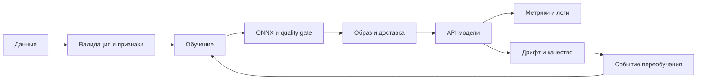

# Учебный гайд по MLOps проекту кредитного скоринга

Этот гайд объясняет, как устроен проект, зачем нужны его компоненты и как последовательно воспроизвести работу над семью этапами. Он рассчитан на читателя, который знает основы Python и машинного обучения, но только начинает работать с инфраструктурой и автоматизацией доставки моделей.

Материал описывает существующий код репозитория. Предлагаемые упражнения помогают его изучить; они не означают, что новый эксперимент уже выполнен. Исторические результаты находятся в `verification.txt` и `reports/`, актуальная оценка соответствия — в [итоговом отчете](../reports/final_report.md).

## Как читать гайд

| Глава | Что изучаем | Какой результат получаем |
| --- | --- | --- |
| [Подготовка и Git](00_preparation_and_git.md) | Окружение, данные, артефакты и исключения Git | Готовая рабочая среда и понятные границы репозитория |
| [Этап 1](01_model_and_onnx.md) | MLP, ONNX, валидация, INT8, CPU/GPU benchmark | Согласованный комплект модели и измерения |
| [Этап 2](02_terraform.md) | Terraform, модули, окружения, state, mock-тесты | Проверенная конфигурация инфраструктуры без облачного запуска |
| [Этап 3](03_docker_and_kubernetes.md) | Docker, DVC, Kubernetes, rolling update | Локально проверенная доставка frontend/backend |
| [Этап 4](04_cicd_and_releases.md) | GitHub Actions, Istio, Blue-Green, Canary, rollback | Автоматизированные проверки и управляемые релизы |
| [Этап 5](05_observability.md) | Prometheus, Grafana, Loki, алерты и runbook | Наблюдение запросов, ресурсов и инцидентов |
| [Этап 6](06_drift_and_seldon.md) | Evidently, зрелые метки, Seldon, A/B, shadow | Мониторинг качества и сравнение версий |
| [Этап 7](07_retraining_and_scaling.md) | Airflow, quality gate, Redis, autoscaling, failover | Контролируемое переобучение и устойчивое обслуживание |

Читайте главы по порядку. Во всех командах текущий каталог — корень проекта. Команды рассчитаны на Linux/Bash. Блоки с `make`, `docker` и `uv run` предназначены для терминала; вывод JSON и схемы предназначены для чтения.

В VS Code нажмите `Ctrl+Shift+V` для предпросмотра Markdown или `Ctrl+K`, затем `V` для просмотра рядом с исходным текстом.

## Как устроен полный цикл

У модели есть два разных жизненных цикла. Первый — экспериментальный: подготовить данные, обучить, оценить качество. Второй — эксплуатационный: упаковать согласованные артефакты, доставить, проверить готовность, наблюдать и откатить при проблемах. MLOps связывает эти циклы версиями данных, кода и модели.

## Границы учебной работы

По [заданию](../task.md) запуск на реальной инфраструктуре не требуется. Для Terraform достаточно конфигураций и локальных проверок. Kubernetes и релизные стратегии демонстрируются в kind, платформенные сервисы — в Docker Compose. Физически разные регионы заменяются локальной моделью топологии при наличии подготовленного сценария регионального размещения.

Не запускайте облачный `terraform apply` ради прохождения этого гайда. Команды реального развертывания находятся в эксплуатационных инструкциях и являются отдельным сценарием, который требует аккаунта, ресурсов и доступов.

Учебная демонстрация отделяет четыре результата:

1. Конфигурация написана и может быть прочитана инструментом.
2. Логика проходит unit/mock-тесты.
3. Компоненты действительно взаимодействуют в локальном стенде.
4. Система работает на целевой инфраструктуре под реальной нагрузкой.

В этой работе используем первые три уровня. Успех mock-теста не доказывает сетевую доступность, а успешный локальный failover не доказывает устойчивость к отключению дата-центра.

## Особенность двух комплектов моделей

В проекте сохранена классическая sklearn-модель из предыдущего курса и добавлена нейросеть. DVC-пайплайн `prepare → train` относится к классической модели `best_model.joblib`. Этап 1 создает PyTorch-веса, scaler и ONNX. Этапы 5–7 используют ONNX, а локальные проверки доставки этапов 3–4 используют синтетическую модель через DVC.

Это объясняет, почему исправный ONNX-файл не заменяет `best_model.joblib` для старого DVC-сценария и почему успех переключения синтетических моделей ничего не говорит об AUC кредитного скоринга. Смотрите на настройку `MODEL_BACKEND` и требования конкретной команды.

## Как оформлять результат самостоятельной работы

Для каждого запуска записывайте цель, команду, версии входных артефактов, среду, ожидаемый результат, фактический результат и вывод. Например: «INT8 уменьшил файл на 63,9%; потеря AUC составила 0,001018; ускорение относительно FP32 зависит от режима нагрузки».

Сырые журналы и временные модели храните в `artifacts/`, содержательные отчеты для сдачи — в `reports/`. Не подменяйте объяснение результата фотографией зеленого интерфейса: нужен критерий, по которому проверка считается успешной.

## Хранение гайда в репозитории

Папка `docs/` не исключена через `.gitignore`. Новые главы видны в Git как неотслеживаемые файлы и могут быть добавлены в будущий коммит. Дополнительные инструкции по воспроизведению работы находятся в `README.md`, `infrastructure/`, `monitoring/` и `.github/README.md`.
