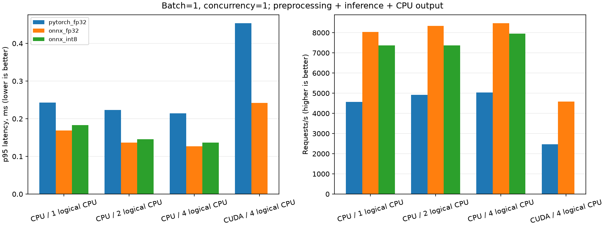

# Benchmark нейромодели

Дата UTC: 2026-11-23T21:37:45.798822+00:00. Хост: `alex-Legion-5-Pro-16ACH6H`.

## Оборудование и ПО

CPU: AMD Ryzen 7 5800H with Radeon Graphics; физических ядер: 8; логических CPU: 16; RAM: 31.2 GiB.
ОС: Linux-7.0.0-42-generic-x86_64-with-glibc2.39; Python: 3.13.13.

Версии: torch=2.15.0, onnx=1.23.2, onnxruntime=1.32.0, numpy=2.5.3, scikit-learn=1.9.1, psutil=7.2.2, onnxruntime-gpu=1.32.0, nvidia-curand=10.4.5.25

GPU probe:
```text
name, driver_version, memory.total [MiB]
NVIDIA GeForce RTX 3060 Laptop GPU, 615.71.09, 6144 MiB
```

## Методика

Каждый backend/CPU-профиль запускается в отдельном процессе. CPU-профили ограничены affinity и являются локальными конфигурациями одного хоста, а не замерами разных облачных инстансов. Число CPU обозначает логические CPU.
Используются реальные строки test-разбиения (20%, stratify, seed=42), тот же порядок признаков и сохранённый StandardScaler. На запрос выполняются scaler.transform, преобразование float32 и инференс с возвратом результата на CPU. Загрузка артефактов и прогрев исключены. HTTP, JSON и сеть не измеряются.
Нагрузка closed-loop: каждый клиент отправляет следующий запрос после ответа. Latency измеряется от начала обработки запроса; ожидание внешней очереди и coordinated omission не моделируются. Throughput считается по общему wall time, а не как обратная величина средней latency.
Прогрев: 50 запросов; измерение: 2 с на повтор; повторов: 3. Таблица — медиана повторов, RSS — максимум.
CPU% процесса: 100% = один полностью занятый CPU. RSS включает среду Python, данные и backend; опрос каждые 20 мс, короткие пики могут быть пропущены. GPU utilization, VRAM и power опрашиваются через nvidia-smi каждые 200 мс; это показатели всей видеокарты, включая графическую среду и другие процессы. GPU-вызовы возвращают результат на CPU, что учитывает синхронизацию и копирование. Для ONNX CUDA размещение узлов проверяется профилировщиком: допускаются метаданные формы на CPU, но не вычислительные операторы. CPU fallback вычислений отмечается skipped. Профилирование отключено во время замеров.

## Результаты



| Модель | Device | CPU | Batch | Клиенты | p50, мс | p95, мс | p99, мс | req/s | объектов/с | CPU% | RSS MiB |
|---|---|---:|---:|---:|---:|---:|---:|---:|---:|---:|---:|
| pytorch_fp32 | cpu | 1 | 1 | 1 | 0.208 | 0.243 | 0.307 | 4574 | 4574 | 100.0 | 688.9 |
| pytorch_fp32 | cpu | 1 | 1 | 4 | 0.188 | 6.243 | 15.211 | 4963 | 4963 | 100.0 | 689.2 |
| pytorch_fp32 | cpu | 1 | 32 | 1 | 0.213 | 0.246 | 0.318 | 4434 | 141887 | 100.0 | 690.4 |
| pytorch_fp32 | cpu | 1 | 32 | 4 | 0.215 | 6.368 | 15.260 | 4371 | 139860 | 100.0 | 690.9 |
| pytorch_fp32 | cpu | 1 | 256 | 1 | 0.311 | 0.340 | 0.414 | 3120 | 798711 | 100.0 | 692.3 |
| pytorch_fp32 | cpu | 1 | 256 | 4 | 0.309 | 9.375 | 15.333 | 3103 | 794324 | 100.0 | 694.2 |
| onnx_fp32 | cpu | 1 | 1 | 1 | 0.112 | 0.169 | 0.188 | 8033 | 8033 | 100.0 | 216.7 |
| onnx_fp32 | cpu | 1 | 1 | 4 | 0.112 | 0.150 | 12.224 | 8085 | 8085 | 100.0 | 219.4 |
| onnx_fp32 | cpu | 1 | 32 | 1 | 0.122 | 0.146 | 0.159 | 7688 | 246006 | 100.0 | 219.5 |
| onnx_fp32 | cpu | 1 | 32 | 4 | 0.123 | 0.189 | 12.234 | 7350 | 235185 | 100.0 | 219.7 |
| onnx_fp32 | cpu | 1 | 256 | 1 | 0.189 | 0.255 | 0.276 | 4973 | 1273029 | 100.0 | 220.2 |
| onnx_fp32 | cpu | 1 | 256 | 4 | 0.189 | 6.251 | 13.269 | 4977 | 1274019 | 100.0 | 221.4 |
| onnx_int8 | cpu | 1 | 1 | 1 | 0.122 | 0.183 | 0.203 | 7377 | 7377 | 100.0 | 217.3 |
| onnx_int8 | cpu | 1 | 1 | 4 | 0.121 | 0.155 | 12.252 | 7606 | 7606 | 100.5 | 219.7 |
| onnx_int8 | cpu | 1 | 32 | 1 | 0.144 | 0.174 | 0.221 | 6478 | 207291 | 100.0 | 219.8 |
| onnx_int8 | cpu | 1 | 32 | 4 | 0.136 | 0.185 | 13.034 | 6779 | 216933 | 100.0 | 220.1 |
| onnx_int8 | cpu | 1 | 256 | 1 | 0.211 | 0.311 | 0.328 | 4415 | 1130226 | 100.0 | 220.6 |
| onnx_int8 | cpu | 1 | 256 | 4 | 0.207 | 6.832 | 13.639 | 4586 | 1173987 | 99.5 | 222.0 |
| pytorch_fp32 | cpu | 2 | 1 | 1 | 0.193 | 0.223 | 0.292 | 4919 | 4919 | 100.5 | 688.8 |
| pytorch_fp32 | cpu | 2 | 1 | 4 | 1.789 | 2.946 | 3.572 | 2210 | 2210 | 140.9 | 689.1 |
| pytorch_fp32 | cpu | 2 | 32 | 1 | 0.316 | 0.336 | 0.409 | 3075 | 98388 | 101.0 | 690.6 |
| pytorch_fp32 | cpu | 2 | 32 | 4 | 2.060 | 3.104 | 3.644 | 1914 | 61243 | 148.5 | 691.6 |
| pytorch_fp32 | cpu | 2 | 256 | 1 | 0.391 | 0.413 | 0.490 | 2505 | 641351 | 113.0 | 693.8 |
| pytorch_fp32 | cpu | 2 | 256 | 4 | 2.094 | 3.329 | 3.964 | 1849 | 473232 | 155.0 | 695.5 |
| onnx_fp32 | cpu | 2 | 1 | 1 | 0.111 | 0.137 | 0.162 | 8335 | 8335 | 100.5 | 216.6 |
| onnx_fp32 | cpu | 2 | 1 | 4 | 0.440 | 0.467 | 0.603 | 6747 | 6747 | 121.5 | 218.8 |
| onnx_fp32 | cpu | 2 | 32 | 1 | 0.147 | 0.164 | 0.197 | 6464 | 206860 | 106.0 | 218.8 |
| onnx_fp32 | cpu | 2 | 32 | 4 | 0.783 | 1.633 | 2.125 | 4653 | 148883 | 144.0 | 219.0 |
| onnx_fp32 | cpu | 2 | 256 | 1 | 0.220 | 0.235 | 0.257 | 4415 | 1130274 | 121.5 | 219.6 |
| onnx_fp32 | cpu | 2 | 256 | 4 | 0.893 | 2.019 | 2.673 | 3975 | 1017477 | 158.9 | 220.3 |
| onnx_int8 | cpu | 2 | 1 | 1 | 0.128 | 0.145 | 0.166 | 7377 | 7377 | 100.5 | 217.5 |
| onnx_int8 | cpu | 2 | 1 | 4 | 0.459 | 0.480 | 0.618 | 6451 | 6451 | 126.5 | 219.9 |
| onnx_int8 | cpu | 2 | 32 | 1 | 0.161 | 0.178 | 0.199 | 5937 | 189994 | 108.0 | 220.0 |
| onnx_int8 | cpu | 2 | 32 | 4 | 0.789 | 1.663 | 2.165 | 4588 | 146802 | 147.5 | 220.1 |
| onnx_int8 | cpu | 2 | 256 | 1 | 0.238 | 0.255 | 0.277 | 4065 | 1040525 | 119.0 | 220.6 |
| onnx_int8 | cpu | 2 | 256 | 4 | 0.928 | 2.136 | 2.856 | 3793 | 971032 | 160.0 | 221.7 |
| pytorch_fp32 | cpu | 4 | 1 | 1 | 0.188 | 0.214 | 0.281 | 5031 | 5031 | 100.5 | 689.2 |
| pytorch_fp32 | cpu | 4 | 1 | 4 | 1.528 | 2.471 | 3.115 | 2525 | 2525 | 150.0 | 689.5 |
| pytorch_fp32 | cpu | 4 | 32 | 1 | 0.321 | 0.367 | 0.436 | 3007 | 96213 | 126.0 | 691.5 |
| pytorch_fp32 | cpu | 4 | 32 | 4 | 1.683 | 2.665 | 3.210 | 2293 | 73384 | 160.9 | 693.4 |
| pytorch_fp32 | cpu | 4 | 256 | 1 | 0.404 | 0.539 | 0.572 | 2304 | 589729 | 133.5 | 695.7 |
| pytorch_fp32 | cpu | 4 | 256 | 4 | 1.725 | 2.656 | 3.176 | 2232 | 571379 | 177.0 | 697.1 |
| onnx_fp32 | cpu | 4 | 1 | 1 | 0.111 | 0.127 | 0.155 | 8469 | 8469 | 100.5 | 217.1 |
| onnx_fp32 | cpu | 4 | 1 | 4 | 0.416 | 0.543 | 0.590 | 7092 | 7092 | 118.5 | 219.2 |
| onnx_fp32 | cpu | 4 | 32 | 1 | 0.142 | 0.159 | 0.174 | 6728 | 215311 | 111.5 | 219.3 |
| onnx_fp32 | cpu | 4 | 32 | 4 | 0.586 | 1.570 | 2.215 | 5586 | 178741 | 144.5 | 219.5 |
| onnx_fp32 | cpu | 4 | 256 | 1 | 0.217 | 0.236 | 0.250 | 4481 | 1147077 | 135.5 | 220.3 |
| onnx_fp32 | cpu | 4 | 256 | 4 | 0.669 | 1.679 | 2.295 | 4955 | 1268386 | 173.0 | 221.4 |
| onnx_int8 | cpu | 4 | 1 | 1 | 0.118 | 0.136 | 0.162 | 7958 | 7958 | 100.5 | 217.5 |
| onnx_int8 | cpu | 4 | 1 | 4 | 0.440 | 0.569 | 0.614 | 6684 | 6684 | 123.5 | 219.8 |
| onnx_int8 | cpu | 4 | 32 | 1 | 0.160 | 0.176 | 0.198 | 6010 | 192315 | 115.5 | 219.9 |
| onnx_int8 | cpu | 4 | 32 | 4 | 0.634 | 1.618 | 2.229 | 5319 | 170201 | 148.5 | 220.1 |
| onnx_int8 | cpu | 4 | 256 | 1 | 0.236 | 0.254 | 0.273 | 4138 | 1059348 | 129.0 | 220.7 |
| onnx_int8 | cpu | 4 | 256 | 4 | 0.690 | 1.724 | 2.356 | 4856 | 1243014 | 179.0 | 222.0 |
| pytorch_fp32 | cuda | 4 | 1 | 1 | 0.391 | 0.454 | 0.580 | 2474 | 2474 | 100.5 | 1042.2 |
| pytorch_fp32 | cuda | 4 | 1 | 4 | 1.751 | 2.525 | 3.075 | 2203 | 2203 | 196.4 | 1043.5 |
| pytorch_fp32 | cuda | 4 | 32 | 1 | 0.409 | 0.494 | 0.606 | 2358 | 75443 | 101.0 | 1070.9 |
| pytorch_fp32 | cuda | 4 | 32 | 4 | 1.880 | 2.656 | 3.220 | 2061 | 65955 | 201.9 | 1071.3 |
| pytorch_fp32 | cuda | 4 | 256 | 1 | 0.438 | 0.515 | 0.626 | 2241 | 573596 | 101.0 | 1071.8 |
| pytorch_fp32 | cuda | 4 | 256 | 4 | 1.924 | 2.759 | 3.290 | 2004 | 513134 | 197.9 | 1072.5 |
| onnx_fp32 | cuda | 4 | 1 | 1 | 0.206 | 0.242 | 0.342 | 4590 | 4590 | 101.0 | 1096.7 |
| onnx_fp32 | cuda | 4 | 1 | 4 | 0.599 | 0.869 | 2.192 | 5482 | 5482 | 169.0 | 1101.1 |
| onnx_fp32 | cuda | 4 | 32 | 1 | 0.208 | 0.234 | 0.349 | 4557 | 145813 | 101.0 | 1109.2 |
| onnx_fp32 | cuda | 4 | 32 | 4 | 0.769 | 1.807 | 2.568 | 4437 | 141975 | 178.0 | 1110.3 |
| onnx_fp32 | cuda | 4 | 256 | 1 | 0.216 | 0.244 | 0.372 | 4373 | 1119594 | 101.0 | 1110.8 |
| onnx_fp32 | cuda | 4 | 256 | 4 | 0.750 | 1.793 | 2.488 | 4544 | 1163200 | 175.0 | 1111.4 |

## Ресурсы GPU (вся видеокарта)

| Модель | Batch | Клиенты | GPU util, % | VRAM peak, MiB | Power, W |
|---|---:|---:|---:|---:|---:|
| pytorch_fp32 | 1 | 1 | 10.2 | 1096 | 27.9 |
| pytorch_fp32 | 1 | 4 | 9.8 | 1144 | 27.9 |
| pytorch_fp32 | 32 | 1 | 13.0 | 1144 | 28.1 |
| pytorch_fp32 | 32 | 4 | 12.0 | 1144 | 28.1 |
| pytorch_fp32 | 256 | 1 | 13.4 | 1144 | 28.4 |
| pytorch_fp32 | 256 | 4 | 13.0 | 1144 | 28.5 |
| onnx_fp32 | 1 | 1 | 13.3 | 1062 | 28.1 |
| onnx_fp32 | 1 | 4 | 15.4 | 1128 | 28.3 |
| onnx_fp32 | 32 | 1 | 16.8 | 1078 | 28.2 |
| onnx_fp32 | 32 | 4 | 15.4 | 1128 | 28.3 |
| onnx_fp32 | 256 | 1 | 18.8 | 1078 | 28.9 |
| onnx_fp32 | 256 | 4 | 19.2 | 1130 | 29.0 |

## Недоступные режимы

- onnx_int8, cuda, CPU=4: Нет чистого GPU-инференса: CPU operators=['DynamicQuantizeLinear', 'MatMulInteger']; CUDA nodes=23

## Конфигурация для production

Предварительные требования: 1000 запросов/с, batch=1, p95 ≤ 10 мс; резерв пропускной способности 50%. Это допущения для выбора, их нужно заменить требованиями сервиса.
Стартовая рекомендация среди измеренных конфигураций: **onnx_int8, cpu, 1 CPU, 1 процесс, 1 inference threads, 4 клиентов**. Худший p95: 0.164 мс; минимальный throughput повторов: 7392 req/s. Стартовый лимит памяти: 512 MiB (не менее 2× наблюдавшегося RSS, округление вверх).
Это выбор стартовой конфигурации, а не доказанный глобальный оптимум или сравнение стоимости облачных инстансов. CPU affinity не является CPU quota. Для production нужны повтор на целевом инстансе, HTTP-тест с заданным arrival rate, длительный soak-тест, измерение очередей и полной памяти контейнера. Для отказоустойчивости предусмотрите минимум две реплики и проверьте N−1.
INT8 уменьшает размер файла, но может проигрывать FP32 по времени. Качество INT8 проверяется отдельно: `make train-nn`, отчёт `reports/quantization.json`.
GPU/CPU разных типов инстансов нельзя сравнить без доступа к ним. Пропущенные GPU-прогоны не являются результатами производительности.

## Воспроизведение

```bash
uv run python -m src.neural.benchmark
```

Для воспроизведения с временным CUDA-окружением используйте `make benchmark-nn-gpu` с теми же `BENCHMARK_ARGS` (версии GPU-пакетов закреплены в Makefile). Для другого хоста повторите команду с отдельным `--output-dir` и `--label`. На GPU нужен совместимый NVIDIA-драйвер и ONNX Runtime с CUDA EP. Динамический INT8 может не поддерживаться CUDA без CPU fallback.

Полные повторы, диапазоны throughput, SHA256 артефактов и параметры — в `benchmark.json` рядом с этим отчётом.

Методика GPU: [PyTorch CUDA timing](https://docs.pytorch.org/docs/stable/notes/cuda.html); [ONNX Runtime CUDA EP](https://onnxruntime.ai/docs/execution-providers/CUDA-ExecutionProvider.html).
